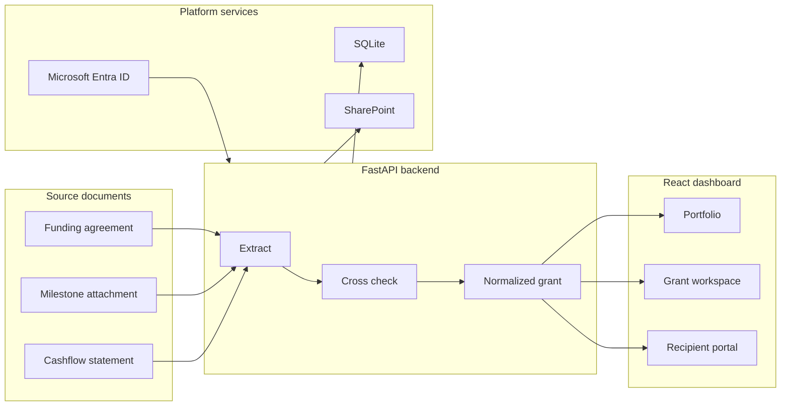

# GrantFlow

GrantFlow is a grant management dashboard for grant management firms. It helps
consultants meet post-award obligations — milestones, expenditure, reporting
deadlines, and evidence — from one workspace.

## Run the dashboard

1. Install [Python 3.9 or newer](https://www.python.org/downloads/) and
   [Node.js 18 or newer](https://nodejs.org).

2. From the repository folder, run:

   macOS, Linux, WSL, or Git Bash:

   ```bash
   ./run.sh
   ```

   Native Windows:

   ```powershell
   .\run.ps1
   ```

   You can also double click `run.bat` on Windows.

3. Open [http://localhost:8000/app/](http://localhost:8000/app/).

The run script creates the Python environment, installs dependencies, builds
the dashboard, and starts the application.

Firm staff sign in at `/app/`; clients sign in at `/app/client/`. On the firm
sign-in page you can **Create a firm account**: GrantFlow creates a private
workspace for your firm and makes you its administrator. In local development
mode you can also choose **Continue as local administrator**. Sign-in codes and
invitations are printed to the server log until SMTP is configured.

## What it does

* Extracts grant data from agreements, milestone attachments, and cashflow
  statements
* Cross checks information before a grant is added
* Tracks milestone budgets and actual expenditure
* Surfaces reporting deadlines and missing evidence
* Gives each firm a private workspace with administrator and grant adviser
  roles, and a separate client portal for client contributors
* Signs people in with a one-time email code, password, Google, Microsoft, or
  the firm's own identity provider (OpenID Connect SSO)
* Supports Microsoft Entra ID and SharePoint configuration

The current proof of concept supports Accelerating Commercialisation and
Boosting Female Founders.

## Architecture



See [Architecture](docs/ARCHITECTURE.md) for the detailed design.

## Use the dashboard

1. Select **Add grant** from the grant portfolio.
2. Choose a program and upload the available grant documents.
3. Review the extracted information and cross check results.
4. Create the grant and manage its milestones, expenditure, actuals, and
   evidence.

## Further development

* Add more grant program extractors
* Replace SQLite with a managed production database
* Complete production Entra ID and SharePoint deployment
* Add synthetic extraction fixtures and continuous integration
* Complete user testing, monitoring, backups, and recovery planning

## Documentation

* [Architecture](docs/ARCHITECTURE.md)
* [API contract](docs/API.md)
* [Adding a grant program](docs/ADDING_A_GRANT_PROGRAM.md)
* [Development standards](docs/DEVELOPMENT.md)
* [Identity and SharePoint setup](docs/IDENTITY_AND_SHAREPOINT_SETUP.md)
